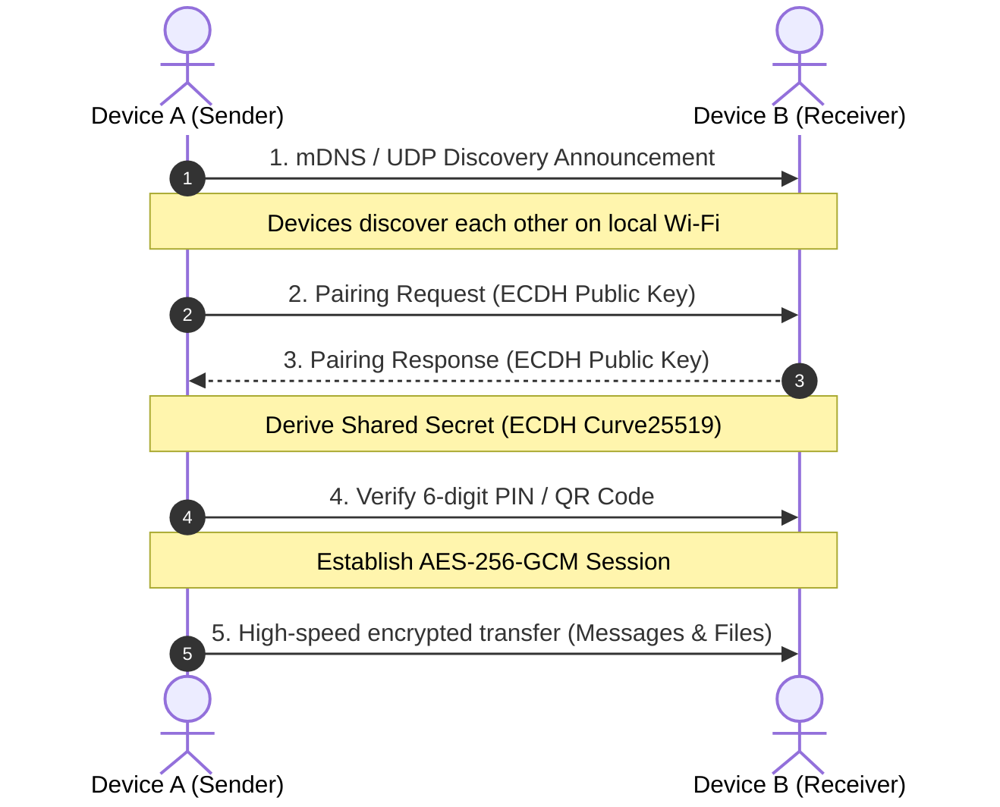

<p align="center">
  
</p>

<h1 align="center">SendChat</h1>

<p align="center">
  <strong>Lightning-fast, 100% free and open-source peer-to-peer local network sharing for Android, Windows, macOS, Linux, and any Web browser.</strong>
</p>

<p align="center">
  <a href="https://github.com/abzgif/SendChat/releases/latest"></a>
  <a href="https://github.com/abzgif/SendChat/blob/main/LICENSE"></a>
  
  
  
</p>

---

**SendChat** is a completely free, open-source, cross-platform local sharing application that connects your phones, tablets, laptops, and desktop computers over your local Wi-Fi or hotspot. No cloud servers, no user accounts, no tracking or telemetry, and no file size limits — just pure, high-speed local network connectivity with end-to-end encryption.

---

## ✨ Key Features

- ⚡ **Zero Cloud & Maximum Speed**: Direct device-to-device streaming across your local network running at your full router / Wi-Fi bandwidth.
- 🌐 **Local Web Share (Zero-Install Sharing)**: Share files with friends or devices without the app (like iPhones, iPads, or public computers) by simply opening a QR code or local URL (`http://<ip>:42831`) in any web browser.
- 🔒 **End-to-End Encryption**: Every session between paired SendChat devices is protected with Elliptic Curve Diffie-Hellman (ECDH) key agreement and AES-256-GCM authenticated encryption. Zero trust, eavesdropping-proof.
- 📡 **Zero-Config Discovery**: Automatic peer discovery powered by mDNS (Multicast DNS) and UDP broadcast fallback. Devices appear instantly without typing IP addresses.
- 🤝 **Fast Mutual Pairing**: Connect securely using QR code scanning or a 6-digit verification PIN to confirm peer authenticity.
- 💬 **Peer-to-Peer Chat**: Fast, offline messaging with delivery confirmations, copy/paste shortcuts, and bulk message cleanup.
- 📁 **Unlimited File & Media Transfer**: Send photos, videos, archives, documents, or entire folders with real-time transfer progress, pause/cancel controls, and native drag-and-drop support.
- 🔔 **Per-Device Notification Controls**: Granular mute / sound toggle for each connected device.
- 🎨 **Adaptive Material 3 UI**: Beautiful, responsive layout built with Jetpack Compose that seamlessly transitions between desktop and mobile form factors.
- 💻📱 **True Cross-Platform**: Native applications for **Android**, **macOS** (Apple Silicon & Intel), **Windows**, and **Linux**, plus universal browser access via **Local Web Share**.

---

## 📥 Downloads

Pre-built binaries for all platforms are available on the **[Releases Page](https://github.com/abzgif/SendChat/releases/latest)**:

| Platform | Format | Description | Download |
| :--- | :--- | :--- | :--- |
| **Windows** | `.exe` / `.msi` | Windows 10 / 11 (64-bit) | [Download Installer](https://github.com/abzgif/SendChat/releases/latest) |
| **macOS** | `.dmg` / `.pkg` / `.app` | macOS 11+ (Apple Silicon & Intel) | [Download macOS](https://github.com/abzgif/SendChat/releases/latest) |
| **Linux (Debian/Ubuntu)** | `.deb` | Ubuntu, Debian, Mint (64-bit) | [Download DEB](https://github.com/abzgif/SendChat/releases/latest) |
| **Linux (Fedora/RHEL)** | `.rpm` | Fedora, RHEL, openSUSE (64-bit) | [Download RPM](https://github.com/abzgif/SendChat/releases/latest) |
| **Android** | `.apk` / Google Play | Android 7.0+ (API 24+) | [Releases](https://github.com/abzgif/SendChat/releases/latest) / Google Play |
| **iOS / iPadOS / Others** | Web Browser | Connect via **Local Web Share** in app | No install needed |

SendChat can check GitHub Releases from **Settings → App Updates** on desktop, download the current platform’s installer, and open it. Android updates are delivered through Google Play.

---

## 🌐 How Local Web Share Works

Need to send files to an iPhone, iPad, or a PC without installing software?
1. Open SendChat and tap the **Web Share** icon (🌐) in the top bar.
2. A QR code and local web URL (`http://192.168.x.x:42831`) will appear.
3. The other device connects using their camera or browser on the same Wi-Fi.
4. **App to Web**: Queue files in the app to let the browser download them instantly.
5. **Web to App**: Drag and drop files or type messages in the browser to receive them on your device immediately.

---

## 🔐 Security Architecture

SendChat is built on a zero-trust local security model:



1. **Discovery**: Devices announce their presence on the local subnet via mDNS (`_sendchat._tcp.local`) and fallback UDP multicast.
2. **Key Agreement**: Devices exchange ephemeral keys using ECDH (Elliptic-Curve Diffie-Hellman).
3. **Verification**: Users verify connection authenticity through a 6-digit confirmation PIN or QR code scan.
4. **Data Transfer**: All chat messages, metadata, and binary file chunks are encrypted with AES-256-GCM before transmission over Ktor CIO sockets.

---

## 🛠️ Tech Stack

- **UI Framework**: [Jetpack Compose](https://developer.android.com/jetpack/compose) & [Compose Multiplatform](https://www.jetbrains.com/lp/compose-multiplatform/) (Material 3)
- **Language**: [Kotlin](https://kotlinlang.org/) (Kotlin Multiplatform 2.1+)
- **Networking**: [Ktor](https://ktor.io/) 3.x (CIO client & embedded HTTP server)
- **Database**: [SQLDelight](https://cashapp.github.io/sqldelight/) 2.x (SQLite driver with coroutines extensions)
- **Discovery**: [JmDNS](https://github.com/jmdns/jmdns) (Desktop) & Android NSD (Network Service Discovery)
- **Cryptography**: [Bouncy Castle](https://www.bouncycastle.org/) (ECDH, AES-256-GCM, SHA-256)
- **QR Codes**: [ZXing](https://github.com/zxing/zxing)

---

## 🚀 Building from Source

### Prerequisites
- **JDK 17** or higher (Eclipse Temurin 17 recommended)
- **Android Studio** (for building Android targets) or IntelliJ IDEA (for Desktop)

### 1. Clone the repository
```bash
git clone https://github.com/abzgif/SendChat.git
cd SendChat
```

### 2. Run Desktop Application (Local Development)
```bash
./gradlew :desktopApp:run
```

### 3. Package Desktop Installers
```bash
# Package for macOS (DMG & PKG)
./gradlew :desktopApp:packageReleaseDmg :desktopApp:packageReleasePkg

# Package for Windows (EXE & MSI - run on Windows)
./gradlew.bat :desktopApp:packageExe :desktopApp:packageMsi

# Package for Linux (DEB & RPM - run on Linux)
./gradlew :desktopApp:packageDeb :desktopApp:packageRpm
```

### 4. Build Android Application
```bash
# Build Android APK
./gradlew :androidApp:assembleRelease

# Build Android App Bundle (for Google Play)
./gradlew :androidApp:bundleRelease
```

---

## 🤝 Contributing

Contributions, bug reports, and feature requests are welcome!
Feel free to open an issue or submit a pull request.

1. Fork the Project
2. Create your Feature Branch (`git checkout -b feature/AmazingFeature`)
3. Commit your Changes (`git commit -m 'Add some AmazingFeature'`)
4. Push to the Branch (`git push origin feature/AmazingFeature`)
5. Open a Pull Request

---

## 📄 License

This project is open-source and licensed under the [MIT License](LICENSE).
